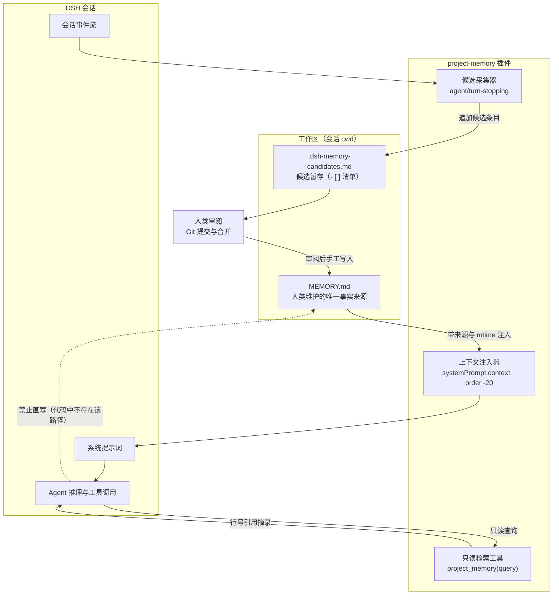

# dsh-project-memory

[](https://www.npmjs.com/package/dsh-project-memory)
[](LICENSE)
[](https://github.com/deepseek-ai)
[](#开发与测试)

> 让 DeepSeek Harness 记住你的项目，但记忆的所有权始终留在人手里。

给 [DeepSeek Harness (DSH)](https://github.com/deepseek-ai) 用的项目记忆插件：把一份手写的 `MEMORY.md` 当作唯一事实来源，在会话中以**带来源标记**的方式注入，并提供**只读**检索工具。模型可以「提议」，但不能「静默写入」。

<details>
<summary>English</summary>

Human-owned, project-scoped memory for DeepSeek Harness. `MEMORY.md` is injected as clearly labeled runtime context, lookups are read-only and cited by line number, and the plugin never writes long-term memory on the model's behalf — the agent proposes, a person reviews in Git.

</details>

---

## 它解决什么问题

大多数 Agent 记忆方案的默认设定是：模型可以自己决定记住什么。这带来三个长期代价：

- **记忆幻觉**：模型把一次推理的中间结论写成「事实」，下次会话再当真事实引用。
- **错误扩散**：错误一旦进入记忆库，会被后续每一次注入放大，而且很难定位是哪一次写坏的。
- **无法回溯**：向量库或数据库里的记忆没有 diff、没有 blame、没有回滚，评审无从下手。

`dsh-project-memory` 的判断是：**值得长期保留的不是模型的想法，而是项目里那些经得起 Review 的决策。** 所以记忆必须是一个普通文件，跟着代码走 Git 流程。

## 设计原则

1. **人类掌控（Human-Owned）**：`MEMORY.md` 是团队唯一的确定性事实来源。Agent 拥有只读检索权，**没有写入权**——代码里不存在任何写 `MEMORY.md` 的路径。
2. **随仓库版本化（Repository-Scoped）**：记忆与代码放在一起，通过提交、合并、Review 获得完整版本历史。
3. **显式来源标记（Labeled Context）**：每次注入都带来源路径与文件修改时间；每次检索结果都带行号，消除「这话是谁说的」这类歧义。
4. **提案式更新（Proposal Workflow）**：模型在会话中发现的约定或事实，只会沉淀为候选条目，由开发者审阅后手工并入 `MEMORY.md`。

## 核心能力

| 能力 | 说明 |
| --- | --- |
| 带来源的上下文注入 | 会话构建提示词时读取工作区根目录的 `MEMORY.md`，注入时附来源路径与修改时间 |
| 只读检索工具 | 提供 `project_memory` 工具，按关键词命中数排序并返回**带行号**的摘录 |
| 字符上限保护 | `maxChars` 限制单次注入长度，超限时在注入文本中显式标注被截断 |
| 候选记忆暂存 | 协作出「提案」：把用户消息沉淀为 `.dsh-memory-candidates.md` 里的 `- [ ]` 待办 |
| 会话隔离 | 以会话工作目录为边界，一个项目一份记忆，互不串味 |
| 路径越狱防护 | `fileName` 解析后必须仍位于工作区内，否则直接报错，不读取外部文件 |
| 改完即生效 | 每次构建提示词时读盘，编辑 `MEMORY.md` 无需重启会话 |

## 架构与数据流



上图虚线是**被明确禁止**的路径：模型与 `MEMORY.md` 之间只存在读的关系。可交互的矢量版本见 [docs/architecture.html](docs/architecture.html)，用浏览器直接打开即可。

## 快速开始

### 1. 安装插件

方式 A：通过 DSH Plugin CLI 安装（推荐）

```bash
dsh plugin --profile web add dsh-project-memory
```

方式 B：手工挂载到 profile 补丁

在你的 profile 配置文件（如 `cordis.patch.yml`）中加入：

```yaml
- insert:
    - id: project-memory
      name: 'dsh-project-memory'
      config:
        fileName: 'MEMORY.md'
        maxChars: 6000
        lazyMode: true
```

### 2. 写下第一份项目记忆

在项目根目录创建 `MEMORY.md`：

```markdown
# Project Memory

## 架构与技术栈
- 前端：React 18 + TypeScript + Tailwind CSS
- 后端：Node.js 22 + Cordis 插件架构

## 关键技术决策
- 所有发往 API 中转站的请求统一走 failover 调度池。
- 拒绝在主分支直接写入未验证的实验性代码。

## 常用命令
- 本地调试：`pnpm run dev`
- 运行测试：`pnpm test`
```

### 3. 验证

启动会话后，模型侧应当能拿到带来源的注入内容；需要历史决策时，它会调用 `project_memory` 并给出带行号的摘录。若文件不存在，插件**静默跳过注入**，不报错、不占上下文。

## 配置参数

| 参数 | 类型 | 取值范围 | 默认值 | 说明 |
| --- | --- | --- | --- | --- |
| `fileName` | `string` | — | `MEMORY.md` | 工作区根目录下的记忆文件名 |
| `candidateFileName` | `string` | — | `.dsh-memory-candidates.md` | 候选记忆暂存文件名 |
| `maxChars` | `number` | 500 – 20000 | `6000` | 注入上下文时的最大字符数，超出部分截断并标注 |
| `maxMatches` | `number` | 1 – 20 | `6` | `project_memory` 单次返回的最大命中行数 |
| `lazyMode` | `boolean` | — | `true` | 是否启用候选采集（关掉即完全只读） |
| `maxCandidates` | `number` | 1 – 100 | `20` | 候选文件内保留的最大条目数 |
| `maxCandidateChars` | `number` | 1000 – 20000 | `6000` | 候选文件的最大字符数，超限则不再追加 |

## MEMORY.md 怎么写

写**结论**，不写**过程**；写**约束**，不写**闲聊**。这份文件每次会话都会被注入，写得越长，信噪比越低。

值得写进去的：

- 技术选型与理由：「用 SQLite 而非 Postgres，因为要离线运行」
- 团队约定：「提交信息用中文 Conventional Commits」
- 禁忌与红线：「不要引入云同步」「不要动 `legacy/` 目录」
- 高频命令与路径

不值得写进去的：

- 一次性的调试过程、临时结论
- 可以从代码里直接读出来的事实（目录结构、函数签名）
- 没有结论的讨论记录

## 运行时行为

**注入样例**（模型实际看到的文本）：

```text
Project memory (human-maintained; source: /home/you/my-project/MEMORY.md; updated: 2026-10-02T07:26:00.000Z). Follow it as durable project context. Do not claim it was generated by you.

# Project Memory
...
```

超出 `maxChars` 时会追加一行 `[Memory file truncated by the configured character limit.]`；文件不存在时整段注入为空，不占上下文预算。

**检索样例**：`project_memory` 把查询按非字母数字字符切分，命中关键词更多的行优先，同分按行号先后，最终按行号升序输出：

```text
Project memory (/home/you/my-project/MEMORY.md):
3: - 所有发往 API 中转站的请求统一走 failover 调度池。
7: - 拒绝在主分支直接写入未验证的实验性代码。
```

**候选样例**：`lazyMode` 开启时，每轮结束采集本轮的**用户消息**（插件注入的运行时上下文与模型输出都会被排除），追加到候选文件：

```markdown
# Memory Candidates

> Auto-captured candidates. Move only reviewed facts into MEMORY.md.

- [ ] 把 SQLite 换成 DuckDB，离线优先。
```

候选是**用户原话的机械截取**，不是模型总结；去重与条数上限都会自动处理。人工审阅后把确认的部分并入 `MEMORY.md`，其余删掉即可。

## 与其它记忆方案的对比

| 方案 | 行为 | 主要风险 |
| --- | --- | --- |
| 自动记忆数据库 | Agent 自动提炼并入库 | 过期或错误的「事实」会变成看不见的权威 |
| 向量记忆 | 按 embedding 相似度召回 | 难以 Review、调试与复现，脱离 Git 历史 |
| 仅靠 `CLAUDE.md` | 优秀的手写指令 | 没有检索工具，也没有来源与行号溯源 |
| **`dsh-project-memory`** | 手写 Markdown + 带来源注入 + 行号检索 | 更新必须由人批准——这是设计意图，不是缺陷 |

它更接近一本**随版本管理的项目笔记本**，而不是一个黑盒记忆仓库。

## 设计边界

诚实说明它**不**做什么：

- **不做语义检索**：匹配是大小写不敏感的词面子串命中，没有 embedding。查询词会被切成词元，长度 ≤ 1 的词元丢弃；若查询中没有有效词元，则返回记忆全文。
- **不做摘要与整理**：候选条目就是用户消息截断到 500 字符后的原文，整理工作留给审阅的人。
- **不做跨项目汇总**：隔离边界是会话工作目录，没有全局记忆库。
- **不做记忆压缩**：注入是整段读取加截断，请把 `MEMORY.md` 控制在 `maxChars` 以内。
- **不清理候选**：候选文件只增不减，需要人工在审阅后删除。

## 开发与测试

```bash
git clone https://github.com/199084/dsh-project-memory.git
cd dsh-project-memory
node --test test/*.test.mjs
```

测试覆盖：带来源的上下文注入、修改时间标记、只读检索命中、截断标记、候选采集（含插件来源消息的排除），以及 **`MEMORY.md` 不被写入** 这一核心断言。

本仓库文档实测环境：`@deepseek-ai/dsh-tools` 0.1.7-rc.2、`@deepseek-ai/cordis` 4.0.4、`@deepseek-ai/schemastery` 3.18.4。

## 文档

- [设计说明](docs/design.md)：设计哲学、数据流、代码结构与失败模式
- [使用手册](docs/usage.md)：安装、配置详解、书写规范与故障排查
- [交互式架构图](docs/architecture.html)：浏览器打开，可悬停查看与导出 SVG
- [项目介绍页](docs/intro.html)：一页读懂这个插件

## 许可证

本项目基于 [MIT 协议](LICENSE) 开源。
